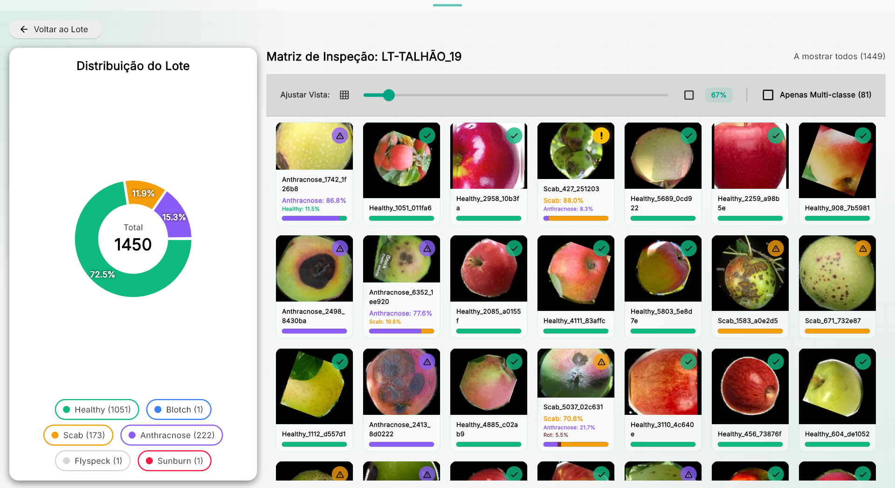
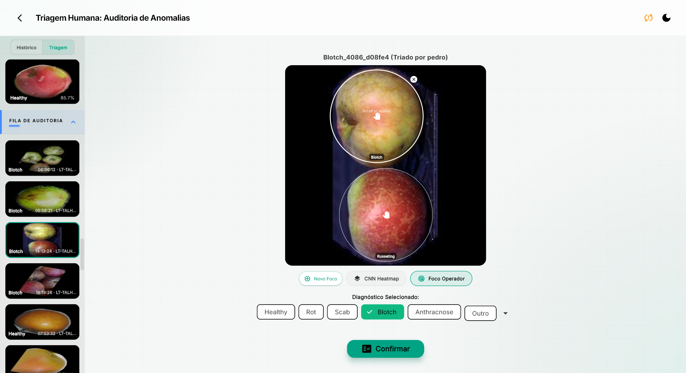

# Apple Quality Classification & IoT Active Learning System

This repository hosts an end-to-end machine learning and hardware-integrated pipeline for automated apple disease classification. Designed for agricultural triage, it combines Edge AI (Raspberry Pi 5), deep learning classifiers (ResNet50 & MobileNetV2), a cloud PostgreSQL backend (Supabase), MLOps tooling for safe model promotion, and a real-time reactive Flutter dashboard.

| Batch inspection matrix | Human-in-the-loop triage (Grad-CAM) |
|---|---|
|  |  |

---

## 1. High-Level Architecture & Data Flow

The system is split into independent, long-running services orchestrated locally by `start_all.ps1`. The Raspberry Pi does cheap binary triage at the edge; a PC-side watcher does the expensive multiclass diagnosis only for the apples that actually need it.

- **Dual-CNN & Load Balancing**: In commercial apple orchards, healthy fresh-market packout typically averages 70% to 85%, while 10% to 20% is diverted to processing and 5% to 15% is culled. Running lightweight binary inference directly on edge camera nodes filters out healthy fruit at the source, resolving 49.6% of total fruit autonomously in our 55/45 test set and an estimated 65% to 75% under typical commercial orchard yields. The edge node writes directly to the database, so bandwidth and server GPU time scale strictly with the uncertain and pathological fraction rather than total crop throughput.
- **Calibration Audit (80% to 85%)**: A 5% audit sample is captured from borderline-healthy classifications (80% to 85% confidence) and routed to human review despite being approved, serving as an early-warning tripwire to verify threshold calibration.
- **Graceful Offline Degradation**: If Wi-Fi or database connectivity fails, edge ONNX inference continues uninterrupted locally on the conveyor belt. Once connectivity is restored, accumulated frames and telemetry are pushed over WebSocket to the backend.

```text
[Raspberry Pi 5 (Edge)] ── raspberry_camera_format.py (--stream)
  - Burst capture (2-3 frames), HSV/Circular Masking
  - CNN2 (MobileNetV2 ONNX, binary), acting as confidence FILTER, not diagnosis authority
  - Embedded MJPEG livestream server (:8000 /stream.mjpg, on-demand)
          │
          ├── ALL frames "Healthy" AND worst confidence > 80%?
          │     └──> writes DIRECTLY to Supabase (REST, anon key):
          │          apples / frames / cnn_predictions / producao_atual
          │          + uploads only the worst frame (final_source "CNN2-Raspberry")
          │
          └── uncertain (<= 80%) or any frame "Unhealthy"?  CNN2 verdict is DISCARDED
                │  WebSocket (JSON + Base64 crops, label "unknown")
                v
        [ws_server.py (:8765 WS / :8766 HTTP)]          [mlops_server.py (:8767)]
          - Saves images + JSON locally (no DB access)    - Training orchestration (POST /train)
          - Heartbeat relay + camera command queue        - Shadow-model runner + auto-promotion
                │  (local folder, polled every 5s)        - GET /compare, /classes, /models
                v                                         - Talks to shadow_runner.py subprocess
        [cnn5_watcher.py (poller)]                                   │
          - Sole authority for uncertain apples                      │
          - Classifies ALL N frames with CNN5 (ResNet50/MobileNet,   │
            production model from models/production.json)           │
          - Picks the "worst case" frame, generates Grad-CAM        │
          - Writes apples/frames/cnn_predictions/producao_atual     │
            for these apples (final_source "CNN5")                  │
                │                                                    │
                v                                                    v
                          [Supabase (Cloud PostgreSQL)]
                            - apples, frames, workers, cnn_predictions
                            - cnn5_multi_confidence, producao_atual
                            - manual_review, manual_annotation, circles_manual, train_dataset
                                            │
                                            v
[Flutter Dashboard (Client)] ───────────────┘
  - Riverpod state management, bcrypt-authenticated (admin / operator)
  - Local JSON cache for offline resilience (local_cache_service.dart)
  - Live MJPEG camera preview (mjpeg_service.dart → Pi :8000, direct)
  - Grad-CAM Human-in-the-Loop review, MLOps/ShadowCNN control panel
```

`inference_server.py` (port 8000, REST `/classify`) ships as a standalone CNN2 inference endpoint for manual/ad-hoc classification; it is not part of the auto-started pipeline in `start_all.ps1`, which instead relies on `cnn5_watcher.py` polling the local JSON queue.

---

## 2. Deep Learning Models & Triage Logic

The system utilizes a dual-CNN cascading architecture to balance edge hardware limitations with high-precision pathological classification.

### 2.1. CNN2: Edge Binary Filter (MobileNetV2)
- **Training**: `CNN2.py` (binary, `num_classes=2`).
- **Deployment**: Raspberry Pi 5 via ONNX Runtime, driven by `ONXX/raspberry_camera_format.py`. The model file lives in the Pi's own local models folder (published there by `mlops_server.py`'s export flow or manual `scp`), not in this repo.
- **Goal**: Rapid binary triage (`Healthy` vs `Unhealthy`).
- **Optimization & Quantization**: Candidate models are benchmarked across Simplified, Quantized INT8, and standard FP32 variants. INT8 quantization (`ONXX/export_quantize_onnx.py`) reduces the model to ~2.2M parameters and 8.7 MB, delivering 15 to 35 ms inference per frame on Raspberry Pi 5 with negligible accuracy loss.
- **Data Augmentation**: `RandomErasing` (p=0.2) forces the network to learn global representations rather than localized patches, paired with strict rotation invariance.

### 2.2. CNN5: Core Multiclass Expert (ResNet50 / MobileNet)
- **Training**: `CNN5.py` (multiclass, `num_classes=5`).
- **Deployment**: `ONXX/cnn5_watcher.py`, which loads whichever model is marked current in `models/production.json` (GPU if available, ~100 img/s).
- **Goal**: Granular pathological diagnosis (5 classes: `Anthracnose`, `Blotch`, `Healthy`, `Rot`, `Scab`).
- **Architecture**: ResNet50 (ImageNet V2 weights) with hierarchical freezing (layers 1-2 frozen, layers 3-4 unfrozen) and a custom Dropout (p=0.5) Fully Connected head. Residual skip connections allow gradients to flow through deep layers without vanishing, capturing fine texture and color boundaries.
- **Training Optimization**: Trained using the Adam optimizer with an initial learning rate of $10^{-4}$. An automated scheduler reduces the rate to $10^{-5}$ when validation loss plateaus, forcing the network to resolve subtle pathological details. Dynamic class weighting is applied during training (e.g., 3× weighting for under-represented classes like Blotch) to prevent majority-class bias.
- **Triage Logic**:
  - If ALL burst frames are `Healthy` with worst-frame confidence `> 80%`, the Pi itself writes the verdict directly to Supabase (`final_source: "CNN2-Raspberry"`) and uploads only the worst frame, so the PC never sees these apples.
  - Otherwise CNN2's verdict is discarded (`label: "unknown"`): the Pi only drops the crops + a JSON descriptor into a local folder via `ws_server.py`, and `cnn5_watcher.py` classifies every captured frame with CNN5, selects the "worst case" (highest confidence of a specific disease, or the lowest-confidence `Healthy` frame if CNN5 finds no disease) and writes the final verdict (`final_source: "CNN5"`).
  - If CNN5's own top confidence is low, the apple still surfaces in the Flutter dashboard's manual-review queue for **Human-in-the-Loop** correction.
- **Open-set / "Outros" handling**: rather than training an unbounded generic "outros" class, confidence bands drive the workflow: `>=70%` auto-accepted, `30% to 70%` sent to operator triage (who may tag "outros"), and `<30%` auto-tagged "outros". Only an admin promotes a recurring "outros" bucket into a new named class once enough samples accumulate. Stress-tested against 915 out-of-distribution web-scraped images (`scrape_apple_diseases.py`) to confirm uncertainty honesty on non-trained pathologies.

### 2.3. MLOps: Shadow Evaluation & Promotion
- `ONXX/mlops_server.py` (port 8767) exposes training, comparison, and shadow-model endpoints consumed by the dashboard's **MLOps/ShadowCNN** page.
- `ONXX/shadow_runner.py` runs a candidate model alongside production, silently scoring the same live apples. After a configurable number of samples it compares F1 against the production model and either auto-promotes the shadow model (archiving the old one and injecting it to the Raspberry Pi via SCP) or archives itself. This is fully autonomous and requires no dashboard session.

### 2.4. Explainable AI (Grad-CAM)
- `cnn5_watcher.py` generates a Grad-CAM heatmap for the selected "worst case" frame of every uncertain apple as part of its normal write path.
- `gradcam_galeria_interativa.py` provides an interactive gallery for exploring Grad-CAM results offline, hooking into `model.layer4` (ResNet50), the final convolutional layer retaining 2D spatial correspondence before classifier flattening. By backpropagating class gradients, it weights activation regions to confirm that predictions stem from genuine biological lesions rather than conveyor reflections, shadows, or background artifacts.

### 2.5. Test-Set Results

Evaluated on a held-out test set of **4785 images** (2640 Healthy, 2145 diseased across 4 pathologies):

| Model | Accuracy | Weighted F1 | Notes |
|---|---|---|---|
| CNN2 (MobileNetV2, binary) | 97.6% | 0.976 | 8 of 2145 diseased frames (0.37%) misclassified as Healthy |
| CNN5 (ResNet50, 5-class) | 97.6% | 0.976 | Healthy: precision 0.993 / recall 0.982 |
| **Combined hierarchical pipeline** | **97.8%** | **0.978** | CNN2 resolved 49.6% of frames locally; 50.4% delegated to CNN5 |

Combined-pipeline confusion matrix (rows = ground truth, columns = prediction):

| Real \ Pred | Anthracnose | Blotch | Healthy | Rot | Scab | Total |
|---|---|---|---|---|---|---|
| **Anthracnose** | 523 | 0 | 3 | 10 | 5 | 541 |
| **Blotch** | 0 | 244 | 1 | 3 | 2 | 250 |
| **Healthy** | 2 | 0 | 2605 | 30 | 3 | 2640 |
| **Rot** | 13 | 1 | 11 | 597 | 2 | 624 |
| **Scab** | 2 | 8 | 4 | 6 | 710 | 730 |

Under 1% of diseased fruit is accepted as healthy by the combined pipeline (19 of 2145 frames), and most residual confusion is between visually adjacent pathologies (Rot ↔ Anthracnose) rather than disease-vs-healthy. Full per-class metrics and methodology are documented in the accompanying project report.

---

## 3. Data Engineering & Preprocessing Pipeline

To ensure the models learn genuine pathologies rather than dataset artifacts, a data sanitation pipeline processes raw datasets (Kaggle, Mendeley, GitHub) down to a clean, deduplicated core dataset.

### 3.1. Background Removal & Edge Segmentation
- **PC Environment (`RGBA_format.py`)**: Uses the `rembg` U²-Net model followed by Convex Hull filling to segment the apple, placing it on a 224x224 black canvas. This normalizes image variance and prevents the CNN from shortcut-learning on background features.
- **Edge Environment (Raspberry Pi, 16 ms Polar Viterbi Segmentation)**: U²-Net is computationally prohibitive on edge CPUs (~10 seconds). In `ONXX/raspberry_camera_format.py`, the system locates the fruit by color in CIELAB, comparing against the median background color. The image is unrolled into polar coordinates from its centroid into 90 radial rays. Using dynamic programming (Viterbi algorithm), it solves for the globally optimal minimum-cost contour rather than trapping in local minima. After a coarse-to-fine refinement step, it yields a 224×224 RGBA image with transparent background in **16 ms on the Pi 5**.

### 3.2. Cascading Deduplication & On-The-Fly Augmentation
Implemented in `pipeline_apple_bom.ipynb`, sanitizing 8 public datasets (~2,500 curated core images across 5 classes) to prevent data leakage through three successive layers:
1. **Cryptographic (MD5)**: Exact byte-match deduplication.
2. **Perceptual (pHash)**: Hamming Distance ≤ 10 based on DCT to catch nearly identical frames.
3. **Semantic (CNN Embeddings)**: Cosine similarity (≥ 0.90) using an unheaded ResNet50 to map and discard heavy geometric augmentations (flips, rotations, zooms) of the same fruit.
- **On-The-Fly Augmentation**: Augmentations are generated dynamically in RAM during training rather than stored statically on disk. This prevents dataset poisoning from inflated duplicate copies leaking across train, validation, and test splits.

### 3.3. Multi-Crop Isolation
- `split_multi_apple_crops.py` handles input images containing clusters of apples, generating dynamic bounding boxes and isolating them based on area percentage thresholds.

---

## 4. Hardware Integration (IoT)

- **Raspberry Pi Camera v3**: `rpicam-still` is utilized in burst mode (`--burst N`, default 2-3 frames at 150ms intervals) via `ONXX/raspberry_camera_format.py`, which pipelines capture and processing across two threads to overlap I/O with inference.
- **Custom 3D-Printed Camera Stand**: Designed and 3D-printed (`suporte_camera/`) specifically for conveyor mounting. Fixes the exact focal distance and optical angle relative to the fruit, guaranteeing geometric and optical consistency between training distributions and live production.
- **Concurrent Processing**: On a Pi 5, burst frames are background-removed via the 16 ms Polar Viterbi pipeline and classified via ONNX Runtime within ~450ms of the first capture.
- **Blur Consensus**: A Laplacian variance score acts as a confidence multiplier. Blurry frames (<50 score) hold less mathematical weight in the final multi-frame consensus than sharp frames (>200 score).
- **Live Preview & Task Priority**: `raspberry_camera_format.py` embeds an MJPEG HTTP server (`:8000/stream.mjpg`) inside the `--stream` process itself. A strict task hierarchy ensures the livestream is non-critical (yielding resources or dropping frames) so the primary conveyor inspection pipeline never drops a frame or suffers race conditions. Consumed by the dashboard's **IoT & Edge** page via `mjpeg_service.dart`.

---

## 5. Backend & Cloud Infrastructure

The bridge between edge inference and the visual dashboard is managed through local WebSocket/HTTP servers and a Supabase (PostgreSQL) backend. Full schema and ER diagram live in [`db_schema.md`](db_schema.md).

### 5.1. Database Schema (Supabase)
- **`apples`**: Master record holding `apple_id`, `location`, and `timestamp`.
- **`workers`**: Dashboard user accounts, storing bcrypt `password_hash`, `role` (`admin` / `operator`), and `is_active`.
- **`frames`**: Child table storing image URLs and per-frame blur/confidence metrics.
- **`cnn5_multi_confidence`**: Per-frame, multi-class confidence scores from CNN5 (top diseases at ≥5% confidence), enabling the "does it know that it doesn't know" open-set analysis.
- **`cnn_predictions`**: Historical predictions tied to specific model versions (`CNN2-Raspberry`, `CNN5`, shadow models).
- **`producao_atual`**: One row per apple holding the current production verdict (`final_class`, `final_confidence`, `final_source`, thumbnail), which is what the dashboard reads by default.
- **`manual_review` / `manual_annotation` / `circles_manual`**: The active-learning loop, including operator corrections, primary-disease annotations, and hand-drawn lesion circles, which feed back into `train_dataset` for future CNN iterations.

### 5.2. Services
- `ONXX/ws_server.py` (WebSocket `:8765`, heartbeat HTTP `:8766`) receives Base64 JSON payloads from the Raspberry Pi and saves images/JSON locally.
- `ONXX/cnn5_watcher.py` polls the local JSON queue for unprocessed, CNN2-uncertain apples, runs CNN5 + Grad-CAM, and writes `apples`/`frames`/`cnn_predictions`/`producao_atual` for these apples (confident-healthy apples are written directly by the Pi, `final_source: "CNN2-Raspberry"`). Processed apples are marked `cnn5_processed: true` in their JSON so the watcher never reprocesses them; on success the local images are deleted, keeping the JSON as a lightweight permanent log.
- `ONXX/mlops_server.py` (HTTP `:8767`) manages training runs and shadow-model lifecycle for the MLOps dashboard.
- `inference_server.py` (HTTP `:8000` on the PC, `POST /classify`) is a standalone CNN2 REST endpoint for manual/ad-hoc classification outside the automated pipeline (same port number as the Pi's livestream, but on a different machine with no conflict).
- `start_all.ps1` / `stop_all.ps1` boot and tear down the PC-side services (`ws_server`, `mlops_server`, `cnn5_watcher`) plus the Flutter dashboard in one command; the Raspberry Pi side runs independently via `systemd` on boot.

---

## 6. Client Interface (Flutter Dashboard)

The `dashboard/` directory contains a Dart/Flutter application (`dashboard/lib/`) using Riverpod for reactive state management, structured as one router (`ui/structure/dashboard_screen.dart`) over feature pages:

| Page | Folder | Access | Purpose |
|---|---|---|---|
| Controlo do Pomar | `ui/global/` | admin | Unified orchard-wide + lot-focused dashboard (merged Global+Lote view, organized by theme, with a "lote em foco" selector) |
| Grelha Lote / Lote Específico | `ui/lote/` | all | Lot grid and per-lot drill-down: confusion matrices, urgency scores, radar charts |
| Triagem Manual | `ui/manual/` | all | Human-in-the-loop review with Grad-CAM overlays and lesion-circle annotation |
| IoT & Edge | `ui/iot/` | admin | Live MJPEG camera preview and edge device status |
| MLOps/ShadowCNN | `ui/mlops/` | admin | Training control, model comparison, shadow-model promotion |
| Relatório | `ui/reports/` | admin | PDF export via `pdf_service.dart` / `printing` |

### 6.1. Authentication
- Accounts are bcrypt-hashed (`workers` table) with no self-service sign-up. An admin provisions accounts manually and controls who has access.
- `SupabaseService.isMockMode` toggles between real Supabase auth and local mock data for development (`main_mock.dart`).
- Roles gate navigation: `admin` sees the full sidebar (orchard control, IoT, MLOps, reports); `operator` is scoped to lot/triage views. See [`AUTENTICACAO.md`](dashboard/AUTENTICACAO.md) for details.

### 6.2. Resilience & Live Data
- `local_cache_service.dart` persists the last-loaded apple dataset to a local JSON file (`local_db/apples_cache.json`) so the dashboard remains usable if Supabase is briefly unreachable.
- `mjpeg_service.dart` streams the Raspberry Pi's live camera feed directly into the IoT page.

### 6.3. Agronomic Urgency Formula & Commercial Grading
The dashboard automatically flags critical crop batches using the formula:
`Urgency = (Contamination Score × 40%) + (Severity Score × 60%)`
*Contamination mapping: Scab=90%, Blotch=80%, Anthracnose=50%, Rot=25%.*
*Severity mapping: Rot/Anthracnose=100% (destroy crop), Scab/Blotch=40% (cosmetic).*

- **Commercial Economic Tiers**:
  - **Class 1 (€0.60/kg)**: 100% Healthy fruit.
  - **Class 2 (€0.40/kg)**: Minor blotch, early superficial scab, or russeting.
  - **Industry Processing (€0.20/kg)**: Scab and up to 40% early anthracnose suitable for juice, puree, or processing.
  - **Discard (€0.00/kg)**: Active rot and deep anthracnose lesions (must be quarantined to prevent storage contamination).
- **Statistical Quality Control**: Integrates **CEP (Shewhart control charts)** to monitor acute contamination shifts against normal limits, and **CUSUM charts** to detect small continuous variations (such as lens fouling or gradual lighting loss).

### 6.4. Triage Interaction & Active Learning
- Provides a Grad-CAM enabled Human-in-the-loop review interface.
- Operators draw semantic circles over falsely classified fruits.
- Approving a review inserts the corrected image and coordinates into the Supabase `train_dataset` table (via `circles_manual` / `manual_review`), continuously reinforcing future CNN iterations.

### 6.5. Client-Side Reporting
- `ui/reports/` compiles sanitary and financial batch summaries into A4 PDF documents.
- Generation is performed 100% client-side in memory without server requests, providing instant in-dashboard preview before export.

---

## 7. Installation

**PC side (training, `ws_server`, `cnn5_watcher`, `mlops_server`, `inference_server`):**

```powershell
python -m venv venv
./venv/Scripts/activate
# GPU (recommended for training + cnn5_watcher — plain "pip install torch" is CPU-only):
pip install torch torchvision --index-url https://download.pytorch.org/whl/cu121
pip install -r requirements.txt
```

`ONXX/shadow_runner.py` (and `cnn5_watcher.py`, which imports its Supabase client) write directly to the database and need the project's **service_role key**, which is never committed and never the same as the dashboard's anon key.

**Credentials setup (one-time)**: fill in `secrets.local.ps1` at the repo root with `SUPABASE_URL`, `SUPABASE_ANON_KEY` and `SUPABASE_SERVICE_KEY`. `start_all.ps1` loads it automatically. The file is never committed (the whitelist `.gitignore` excludes everything not explicitly allowed; verify with `git check-ignore secrets.local.ps1`). Alternatively, set the same three `$env:` variables per session by hand.

**Raspberry Pi (edge capture, ONNX-only — no PyTorch):** see `ONXX/requirements_export.txt` and `ONXX/raspberry.md`.

**Dashboard (Flutter):**

```powershell
cd dashboard
flutter pub get
```

The dashboard needs Supabase credentials at run time. It never reads them from source. Set them once per shell session:

```powershell
$env:SUPABASE_URL = "https://<your-project>.supabase.co"
$env:SUPABASE_ANON_KEY = "<your-anon-key>"
```

See [`dashboard/README.md`](dashboard/README.md) for the full `--dart-define` setup and the offline mock entry point (`main_mock.dart`).

---

## 8. Running the System

```powershell
# PC side: ws_server, mlops_server, cnn5_watcher (background) + Flutter dashboard (foreground)
# Credentials come from secrets.local.ps1 (loaded automatically) or session env vars — see Installation
./start_all.ps1                       # defaults to -Device windows
./start_all.ps1 -Device chrome        # or any other flutter device

# Tear down background services if start_all.ps1 didn't exit cleanly
./stop_all.ps1
```

The Raspberry Pi side (`ONXX/raspberry_camera_format.py`) is not launched by these scripts. It runs continuously via `systemd` on the Pi and connects to `ws_server.py` over `ws://<pc-ip>:8765`.

Repository size note: trained weights (`*.pth`), exported ONNX models, and raw/intermediate dataset folders (`pipeline_*`) are intentionally excluded from version control (see `.gitignore`). Only source code, the `dashboard/` app, and the `ONXX/` edge/MLOps toolchain are tracked.
